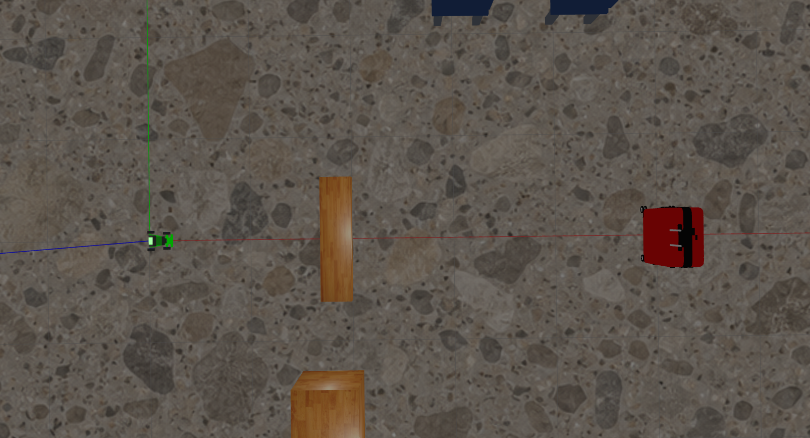
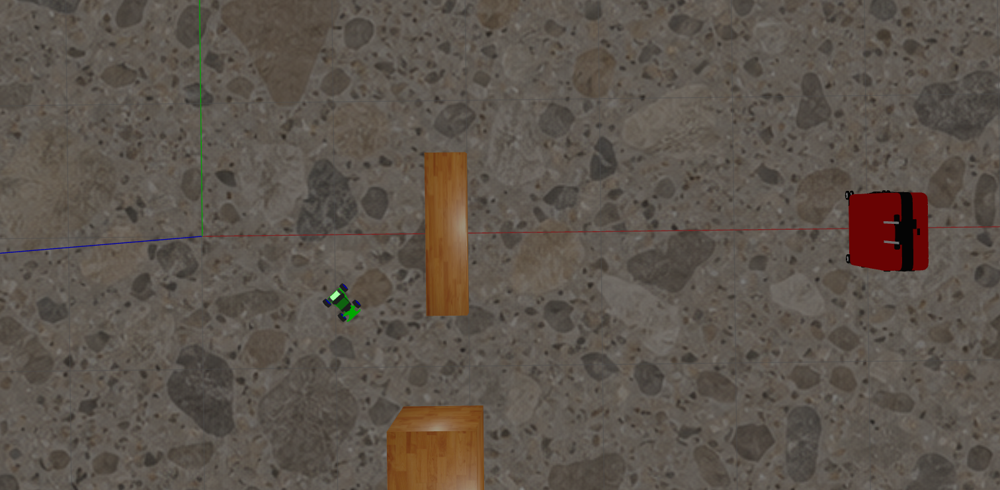
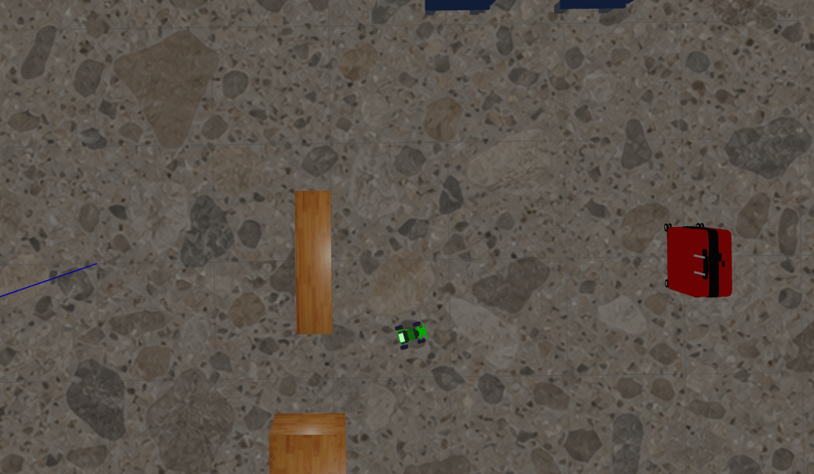
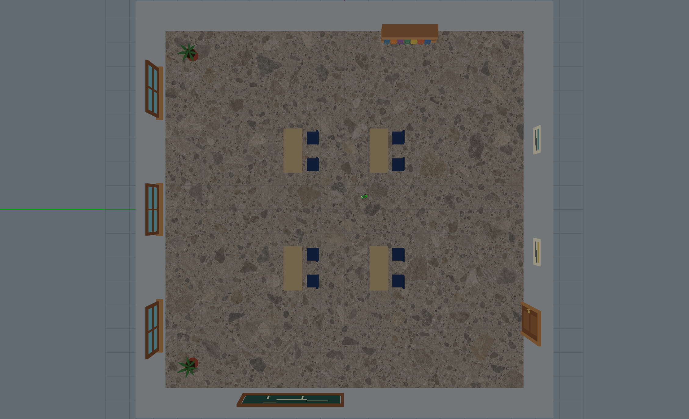
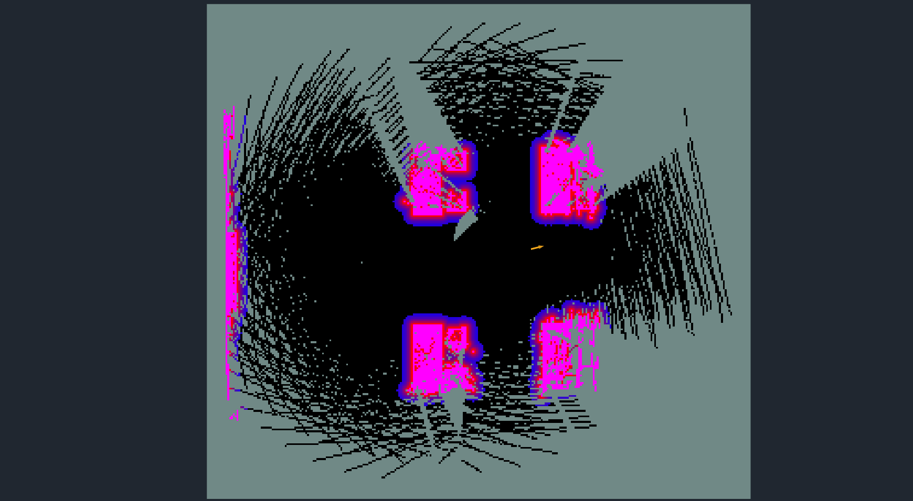

# PiRacer Follow-Me

[](https://github.com/Adiksoon/Follow-Me-Piracer-Sim/actions/workflows/ci.yml)

**An autonomous PiRacer that finds a suitcase and follows it through an indoor environment.**
This engineering thesis project combines RGB-D perception, visual odometry,
mapping and navigation on a small Ackermann-steered vehicle. This branch
contains the Gazebo Classic simulation.

## Demo

A wooden obstacle blocks the direct path from the green PiRacer to the red
suitcase. These Gazebo frames show the robot approaching, turning around
the obstacle and moving past it.

| Approach | Detour | After passing |
| --- | --- | --- |
| <a href="docs/images/detour-start.png"></a> | <a href="docs/images/detour-middle.png"></a> | <a href="docs/images/detour-end.png"></a> |

<details>
<summary>Classroom and Nav2 costmap</summary>

| Gazebo classroom | Nav2 global costmap in RViz |
| :---: | :---: |
|  |  |

*Screenshots from the same paused SEARCH run. The costmap shows how Nav2
represents the classroom arrangement for planning.*

</details>

## How it works

- **Perception.** YOLO11n detects the suitcase in the RGB image. The depth
  image and camera calibration give its 3D position. A separate depth
  projection supplies obstacle observations.
- **Mapping and navigation.** RTAB-Map estimates motion and builds an
  occupancy map. Nav2 uses Smac Hybrid-A* and Regulated Pure Pursuit to
  plan and execute forward motion.
- **Robot behavior.** SEARCH explores boundaries between observed and unknown
  space, using frontier ranking from
  [m-explore-ros2](src/piracer_search/third_party/m-explore-ros2/README.md).
  ACQUIRE confirms or reacquires the target. FOLLOW regulates distance and
  heading directly and can use Nav2 to go around an obstacle. The State
  Manager coordinates transitions between these behaviors.

## What I built

- [Behavior coordination](src/piracer_state_manager/piracer_state_manager/state_node.py).
  I implemented the transition logic for SEARCH, ACQUIRE and FOLLOW, including
  the handoff between behaviors that issue drive commands.
- [RGB-D target localization](src/robot_perception/robot_perception/target_point.py).
  I combined suitcase detections with depth to obtain a 3D target and select
  the nearest valid observation.
- [Direct following](src/piracer_state_manager/piracer_state_manager/follow_control.py)
  and [obstacle detours](src/piracer_state_manager/piracer_state_manager/follow_node.py).
  I implemented distance and steering control and integrated Nav2 for detours
  when an obstacle blocks the direct path.

## Build

Use Ubuntu 22.04 with ROS 2 Humble and initialized `rosdep`.

```bash
git clone --branch main-sim https://github.com/Adiksoon/Follow-Me-Piracer-Sim.git
cd Follow-Me-Piracer-Sim
source /opt/ros/humble/setup.bash
rosdep update
rosdep install --from-paths src --ignore-src --rosdistro humble -y
colcon build --symlink-install
source install/setup.bash
```

The detector needs OpenCV DNN with support for the exported YOLO11n model.
OpenCV 4.13.0 loaded this model in the project environment. Ubuntu 22.04's
OpenCV 4.5.4 failed to load an attention layer. Use an OpenCV build compatible
with the Python environment used by ROS 2 and `cv_bridge`.

## Preview without detector weights

To see the classroom and the robot, start the base scene from the built
workspace. This preview needs neither a detector model nor RTAB-Map at runtime.

```bash
ros2 launch robot_simulation piracer_sim_base.launch.py \
  gui:=true start_paused:=true camera_viewer_enabled:=false \
  visual_odometry_enabled:=false suitcase_control_gui:=false yolo_enabled:=false
```

To inspect the live occupancy map, stop the base scene and start the
standalone mapping launch instead. It starts the RGB-D camera, visual
odometry and RTAB-Map with the detector disabled.

```bash
ros2 launch piracer_navigation slam_nav2.launch.py gui:=true nav2_autostart:=false
```

In another terminal with the workspace sourced, start RViz:

```bash
rviz2 --ros-args -p use_sim_time:=true
```

In RViz, set **Fixed Frame** to `map` and add a **Map** display on `/map`.
The map expands as the robot sees new parts of the room. To inspect more
than the initial view, send a slow forward command while the path is clear:

```bash
ros2 topic pub -r 10 /cmd_vel geometry_msgs/msg/Twist '{linear: {x: 0.05}}'
```

Stop the publisher with **Ctrl+C**, then publish a zero command:

```bash
ros2 topic pub --once /cmd_vel geometry_msgs/msg/Twist '{}'
```

This preview runs without the SEARCH, ACQUIRE and FOLLOW behaviors. Use
the full simulation below to try suitcase following.

## Run the full simulation

Obtain the fine-tuned single-class YOLO11n suitcase model (`best.onnx`) from
the project author. Git and the build do not download the weights. The default
COCO YOLO11n model uses a different class layout from the full simulation
profile. The FT01 model used here has this SHA-256 checksum:

```text
3556781d1c06c667a4b2f97f6fe4a028534302544946c8474bdabb74be7d5f82
```

```bash
ros2 launch piracer_state_manager piracer_sim.launch.py \
  yolo_model_path:="/absolute/path/to/best.onnx" \
  follow_publish_cmd_vel:=true
```

Gazebo starts paused. Press Play to start simulation time. SEARCH starts
after receiving fresh detector messages. The explicit `follow_publish_cmd_vel`
option enables drive commands from FOLLOW. SEARCH and ACQUIRE can still
issue Nav2 goals with that option disabled.

## Verification

GitHub Actions runs unit tests of the state machine, FOLLOW controller and
perception logic on Python 3.10. A separate ROS 2 Humble job exercises detection
messages, target confirmation and control handoffs. Both jobs run without
Gazebo or detector weights.

At revision `5bbbb8c`, all 10 packages built in a fresh local clone. The
offline checks passed 783 Python tests and the C++ frontier test suite.
The FT01 model also completed offline inference with OpenCV DNN.

## Package guides

[Simulation](src/robot_simulation/README.md),
[navigation](src/piracer_navigation/README.md),
[perception](src/robot_perception/README.md) and the
[State Manager](src/piracer_state_manager/README.md).
